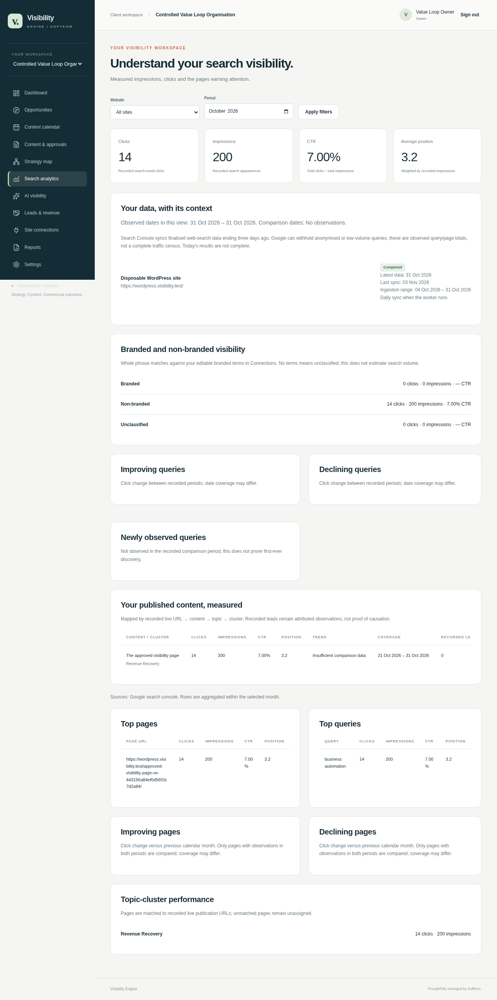
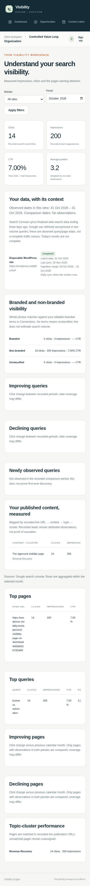
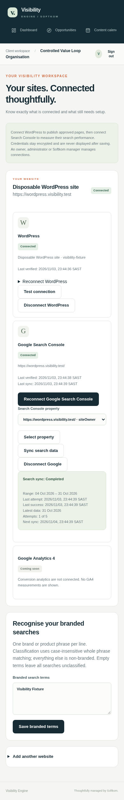

# Visibility Engine Phase 2 — implementation and acceptance evidence

This phase implements the publish-and-measure value loop on
`feature/visibility-engine-client-v1`. It preserves V1 authentication, tenant
scope, revision approvals, attribution and migration history. PR #38 must remain
a draft. Nothing is merged or deployed to production.

## Prepared journey

The browser acceptance test signs into a real test organisation, connects the
**disposable real WordPress installation**, tests its Application Password,
approves revision 1, requests publication and runs the worker. It then sees a
verified LIVE URL, completes **controlled Google OAuth** with state/PKCE,
selects a Search Console property, requests/executes a sync and sees persisted
clicks, impressions, CTR and position against that published content and cluster.
It also checks a foreign tenant filter, mobile layout and logout.

The Google consent, token, property and measurement responses are deliberate
fixtures, isolated in test code. They are not real Google-account evidence or
production observations. Screenshot records are explicitly named test records.

## Changed-file summary

| Area | Paths | Result |
| --- | --- | --- |
| WordPress and destination safety | `lib/connections/http.ts`, `service.ts`, `lib/publishing/wordpress.ts` | Public HTTPS and DNS/IP pinning, per-hop checks, encrypted Application Passwords, permission verification, safe errors, connect/test/reconnect/disconnect |
| Publishing | `lib/workflow.ts`, `lib/publishing/worker.ts` | Exact requested snapshot, revision approval, deterministic remote identity, atomic fenced claim, bounded retry, stored remote ID and public verification |
| Google and ingestion | `lib/analytics/google.ts`, `service.ts`, `sync.ts`, OAuth callback route | Single-use tenant/user/site state, PKCE, encrypted offline tokens, refresh, accessible property selection, scheduled/manual sync and property-scoped persisted measurements |
| Scope and review | `lib/scope.ts`, `lib/context.ts`, `lib/workflow.ts` | Framework-independent scoped database helpers for workers; optional assigned-reviewer rules without a manager approval bypass |
| Client experience | `components/connections.tsx`, `search-insights.tsx`, `views.tsx`, content detail and actions | Safe credential forms, health/freshness/retry states, overall/page/query/branded/cluster/content measurements and linked stored leads |
| Database | `prisma/schema.prisma`, migrations 004 and 005 | Additive locks, OAuth state, sync jobs, revision routing snapshots and property scope |
| Operations and checks | `scripts/worker.ts`, test-service/browser scripts, tests, CI, README | Bounded scheduler command, disposable WordPress, isolated Google fixtures, HTTPS browser tests and reproducible instructions |

Tracked WordPress application files are unchanged. Runtime credentials, local
TLS private keys, `.env`, dependencies, build outputs and browser traces are
ignored. No production credentials are committed or printed.

## WordPress integration

Connections use the standard WordPress REST API and Application Passwords. A
public canonical HTTPS installation URL is normalised; embedded credentials,
non-HTTPS schemes, loopback/local/private/link-local/metadata ranges, non-public
DNS results and unsafe redirects are rejected. All resolved addresses are
checked and the selected address is pinned to the TLS socket; Host and SNI come
from the validated URL. Cross-origin auth forwarding and redirected writes are
blocked. DNS, response size, request time and total provider operation are bounded.

Verification checks the REST namespace, authenticated user and create/publish/edit
page capabilities. Only an authenticated AES-256-GCM envelope is stored. The
workspace selects safe metadata explicitly and never returns credentials. Safe
errors and audit events contain codes and approved constant messages, not raw
provider payloads.

A publication reads `ContentRevision` matching `requestedRevision`. Title, body,
SEO fields, slug and funnel are validated from that snapshot. New editable copy
cannot replace it. The visible HTML remains the approved HTML; only a hidden
identity marker is appended. The slug retains the approved prefix with a stable
publication identity suffix. WordPress title and excerpt are supported; arbitrary
SEO-plugin meta fields are **not** claimed as configured.

The publication ID determines remote reconciliation identity. Before creating a
page the provider looks for that identity; retries update the saved remote ID or
recover a page whose create response was lost. The remote ID and URL are saved
before verification. Verification checks the REST resource's ID, published state,
identity and approved raw body, then GETs the public page and checks its marker.
Unverified public pages remain FAILED with a distinct verification error and
retain the remote resource for a safe retry. Only verified records are LIVE.

WordPress core does not offer a transactionally atomic external idempotency-key
API. The tested concurrency/retry/lost-response paths are protected by fenced
local claims, hard time limits, deterministic slug lookup and retained remote
IDs. Arbitrary remote plugin behaviour or extreme delayed remote execution is
not represented as an exactly-once distributed transaction guarantee.

## Worker design

`npm run worker` is a one-shot supervised/scheduled command: enqueue daily GSC
work, process a bounded batch of publications and syncs, then exit. It is safe to
invoke concurrently. A scheduler must run it, normally once per minute; this
change does not deploy a production scheduler.

Publication and search workers atomically compare-and-set job state, assign a
random fencing token, increment attempts and commit the claim before HTTP. Result
writes require the same token. Ten-minute leases outlast the provider deadlines;
stale claims can be recovered, and an expired final attempt becomes a visible
FAILED/dead-letter record. There are five attempts with exponential backoff capped
at one hour. Job state, failure, last attempt, next retry and successful verification
or sync timestamps are persisted. Duplicate publication requests use a unique
content/revision job key; each connection has one reusable sync job.

No database transaction remains open during external HTTP. Search completion locks
the connection row to serialize writes with property changes/disconnection; an
old in-flight sync cannot restore a removed connection or publish stale metrics
under a new property generation. Database scope helpers no longer import Next.js
request/session APIs, so worker commands run in ordinary Node processes.

## Google Search Console design

OAuth requests only `webmasters.readonly`, offline access and explicit consent.
State is random, stored hashed, single-use and expires after ten minutes. It is
bound to the authenticated user, organisation, site and connection generation.
The PKCE verifier is encrypted. The callback consumes state atomically and stores
access/refresh tokens only in encrypted envelopes. Refresh uses expiry headroom,
checks connection generation and audits safe state changes. Disconnect removes
local credentials first and attempts Google revocation; revocation failure is
recorded without restoring access.

The operator must configure a Google Cloud project, Search Console API, consent
screen, client ID/secret and the exact matching HTTPS callback/auth origin.
`.env.example` documents the names; no real Google credentials are present.
Production's HTTPS callback guard remains intact.

Properties are listed during OAuth and rechecked during selection and sync.
URL-prefix and domain properties are supported without assuming their identifier
equals the WordPress URL. Only a property accessible to that connection's Google
account can be selected. All operations remain site/organisation scoped.

Sync requests finalised web-search data by date, query and page, paginates within
a bounded row limit and rejects partial/invalid responses. The rolling 28-day
window ends three UTC calendar days ago. Upserts use a deterministic hash of
site, property, date, query, page and source. The selected property/range is
replaced atomically, including observations withdrawn by Google. Manual data and
other properties are retained separately. Dashboard reads filter to the selected
property, use persisted rows and make no live provider calls.

The UI shows returned coverage, latest data date, requested/successful ranges,
last sync, next retry/scheduled cadence and failure state. It explains reporting
delay, finalised data and withheld anonymised/low-volume queries. CTR is clicks
/ impressions; position is impression-weighted. Trends show comparison limitations.
Branded classification is editable NFKC, case-insensitive whole-phrase matching;
no configured terms means unclassified. URL/content/topic/cluster and lead links
use stored deterministic relationships. Revenue causation is never inferred.

## Reviewer permissions

Assignments are optional and must name an OWNER, ADMIN or CLIENT member of the
same organisation. When assigned, only that member can approve/request changes;
all organisation members may comment. With no assignment, OWNER, ADMIN and CLIENT
may approve/request changes. SOFTKOM_MANAGER cannot approve as the client. The
existing explicit audited manager exception remains, with its minimum reason
length. New revisions require new approvals and old snapshots remain intact.

## Additive migrations

- `202611030004_publish_search_loop`: connection health/account/property/token
  metadata and generation, OAuth state, sync jobs, publication claim/verification
  metadata and deduplication key, measurement grain keys, organisation brand
  terms and snapshot slug/funnel. Existing snapshots receive routing fields;
  every historical publication is retained, with the newest legacy job per
  content/revision chosen as its deduplication boundary.
- `202611030005_search_property_scope`: nullable property identifier and an
  index on existing SearchMetric rows. Unknown historic property identifiers
  are not invented. Other-provider/manual rows and old property observations
  are preserved.

The standard migration runner still uses advisory locking, per-migration
transactions, immutable SHA-256 checksums and the Prisma ledger. Tests apply
both new migrations to preserved V1 data, deliberately fail and roll back each,
verify original content and schema remain, then apply successfully. Existing
repeat-application, changed-checksum and partial-SQL rollback tests also run.
No destructive migration, reset or `db push --accept-data-loss` is used.

## Executed validation

Validation uses Node 24, PostgreSQL 17, PHP 8.2, WordPress 7.1.4, MariaDB 11.4 and
Chromium against a local production Next.js build. Final results are recorded
below; remote CI execution is not claimed.

| Check | Result |
| --- | --- |
| Prisma generate / validate / migration repeat | Passed; both additive migrations applied and checksums reverified |
| Typecheck | Passed |
| ESLint | Passed, no warnings |
| Unit / database / real WordPress tests | 36 passed across six files; none skipped |
| Production build | Passed |
| Browser acceptance | 10 passed; none skipped, no Playwright retries |
| One-shot worker command | Passed; empty queue exits cleanly |
| Production dependency audit | Zero vulnerabilities |
| Whitespace / tracked WordPress scope | Passed |

Tests cover SSRF range/DNS/redirect checks and pinned lookup, encryption/tamper,
error sanitisation, revision selection, duplicate requests, competing workers,
lost responses, verification retry, attempt limits, property partitions,
refresh, OAuth state reuse/tenant mismatch, metric upserts, reviewer permissions,
tenant reads/mutations and migration preservation/rollback.

The real WordPress tests authenticate generated Application Passwords, reject
wrong credentials and insufficient rights, create/verify a real page and confirm
same-ID retries. Test sockets route explicitly to the disposable loopback
WordPress server; this is real WordPress REST/HTML evidence, not real Internet
DNS/TLS evidence. Test-created pages are deleted where practical.

Browser Google requests are routed by a **test-only preloader**, never imported
by production application code. Controlled consent verifies PKCE, and token/
property/measurement fixtures exercise the actual callback and persistence code.
The browser app uses a separate HTTPS fixture with a freshly generated local
certificate. Node trusts that certificate and Chromium pins its exact SPKI;
production callback and destination protections are unchanged. Login tests
respect the production rate limiter instead of turning it off.

## Screenshots

These screens contain explicit controlled test organisations and measurements;
they are not production dashboards or claims of Google-account validation.

## Remaining limitations and intentionally deferred work

- Real Google consent, access/refresh/revocation and quota behaviour require a
  configured staging Google project and real account/property. They have not
  been validated against Google. Production egress and a supervised worker also
  require staging/operator verification before rollout.
- WordPress SEO-plugin-specific meta fields, remote plugin compatibility and
  distributed exactly-once guarantees beyond the tested reconciliation paths
  are not claimed. Core title/excerpt and approved body publication are verified.
- GA4 is explicitly unavailable. AI monitoring, CRM imports, inline comment
  anchors/resolution, billing/Stripe, backlinks, extra CMSs, public signup,
  cross-client admin and white-label billing are intentionally deferred.
- GitHub REST/GraphQL access is denied in this environment. The user supplied
  the acceptance review and issue #39 requirements. Git branch commits/pushes
  can update PR #38's code, but the PR description/comment cannot be updated
  through the denied API. Prepared review text is in `PHASE2_PR_UPDATE.md`.
- No merge, production deployment or live Softkom WordPress modification occurred.
