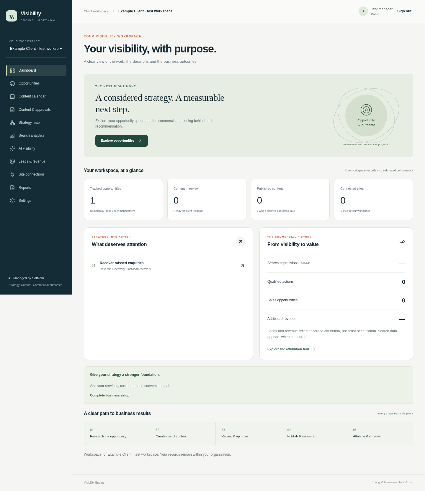
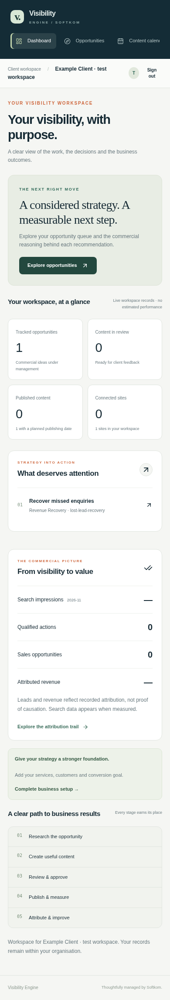
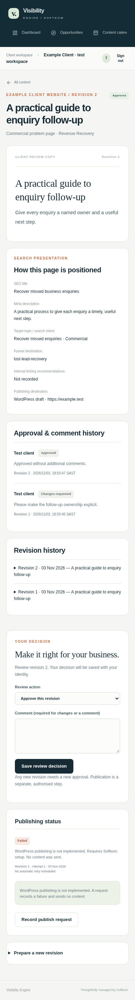

# Visibility Engine client V1 — review evidence

This change replaces the external app's static dashboard with an authenticated,
database-backed organisation workspace. It does not change Softkom's internal
WordPress application or deploy anything.

## Changed-file summary

| Area | Main paths | Result |
| --- | --- | --- |
| Authentication and tenancy | `apps/visibility-engine-client/lib/auth.ts`, `lib/context.ts`, `app/api/auth`, `middleware.ts` | Better Auth sessions, membership checks, role permissions, origin protection, CSP and uncached tenant reads |
| Domain services | `lib/workflow.ts`, `lib/security.ts`, `lib/queries.ts` | Validated opportunities, revision-specific reviews, audited publication requests, manual attribution and measured reporting |
| Data and operator tooling | `prisma/schema.prisma`, `prisma/migrations`, `scripts` | Additive models, same-site foreign keys, preservation migrations, transactional deployment and secure account provisioning |
| Product experience | `app/workspace`, `app/login`, `app/onboarding`, `components`, `app/styles.css` | Responsive shell, four-step onboarding, dashboard, opportunities, calendar, content review/history, strategy, search/AI views, leads, reports, settings and truthful connection states |
| Provider boundaries | `lib/publishing`, `lib/analytics`, `lib/connections` | Typed provider interfaces and server-side authenticated encryption; no implied live integration |
| Reproducibility and checks | `package-lock.json`, TypeScript/ESLint/Prisma/Vitest/Playwright configuration, `tests`, `.github/workflows/visibility-engine-client.yml` | Pinned dependencies, executable test suites and scoped CI |

All changes are confined to the external client app, its CI workflow and this
evidence directory. Tracked WordPress application files are unchanged. Actual
environment files, credentials, dependencies, build outputs and browser traces
are ignored. SQL migration files have an explicit ignore-rule exception so they
are committed even though repository-wide database dumps are excluded.

## Database changes

1. `202611030001_baseline`: the original scaffold schema, for fresh databases.
2. `202611030002_client_workflow`: adds auth sessions/accounts/verifications/rate
   limits; organisation business profiles; research reasoning and evidence;
   content revisions, comments and reviewer relations; audit records; connection
   states and encrypted credential slots; publication attempts, overrides and
   retry metadata; AI observations; lead stage, origin, content and currency.
   Composite keys enforce matching site IDs for related topics, content,
   publications and attribution.
3. `202611030003_legacy_revision_snapshots`: snapshots existing content without
   altering its copy and establishes truthful unavailable connection records for
   existing sites.

Existing models, content and subscription data are retained. Existing deployments
without a ledger must verify and baseline the original schema before applying
the additive migrations. Inconsistent historic cross-site references require
explicit correction rather than destructive automatic repair.

The runtime uses Prisma's JavaScript query engine and PostgreSQL driver adapter.
SQL was generated with Prisma's WASM schema engine. Because Prisma 6's
experimental WASM deployment adapter cannot decode PostgreSQL's catalog `name`
type, `npm run db:migrate` uses a PostgreSQL SQL runner with advisory locking,
per-migration transactions, SHA-256 verification and the standard Prisma ledger.
Native Prisma migration tooling remains compatible. The runner rejects changed,
missing and unfinished migrations and refuses an unbaselined existing schema.

## Executed validation

Validated on Node 24, PostgreSQL 17 and installed Chromium 154, using a local
production Next.js server. These are current-instance results; remote CI has not
been claimed as executed.

| Check | Result |
| --- | --- |
| `npm run db:validate` | Passed |
| `npm run db:migrate`, repeated | Passed; checksums verified without reapplying |
| `npm run typecheck` | Passed |
| `npm run lint` | Passed |
| `npm run build` | Passed; all workspace routes rendered dynamically |
| `npm test` | 18 passed across three files; none skipped |
| `PLAYWRIGHT_CHROMIUM_EXECUTABLE=/usr/bin/chromium npm run test:browser` | 9 passed; none skipped; no Playwright retries |
| `npm audit --omit=dev` | Zero vulnerabilities |
| `git diff --check` | Passed |

Unit/database checks include encrypted-credential tamper detection, content
sanitisation, safe return paths and website URLs, weighted search calculations,
unavailable providers, approval versioning, permissions and audit writes.
Migration tests run against a separate temporary database and demonstrate that
original content survives, snapshots are retained, repeat application is safe,
checksum changes are rejected and failing SQL rolls back without a partial table
or success ledger entry.

Browser tests exercise real login/logout and database sessions, disabled public
signup, rejected cross-origin sign-in, all onboarding steps, researched
opportunity/content creation, change requests, revisions, approvals and history,
truthful unavailable publishing, the content calendar, all reporting views and
mobile layouts. Save feedback settles before a document refresh; tests assert
the persisted visible result rather than relying on transient toast timing.

## Tenant-isolation and security evidence

- Two independent organisations are used in PostgreSQL tests. Foreign site IDs,
  content IDs, list filters, topics and reviewer assignments are rejected.
- Cross-tenant reads, reviews, revisions, status changes, publication requests
  and attribution links cannot expose or mutate the other organisation's data.
- A database-level test attempts a cross-site content/topic relation and confirms
  the foreign key rejects it.
- Browser tests attempt foreign record URLs, a foreign site filter and a forged
  organisation selector cookie. No private client content is shown.
- The browser intercepts and changes the **actual transmitted server-action
  payload** to point at another organisation's content. The server rejects it;
  the foreign record retains its original DRAFT status.
- CLIENT can review but cannot manage sites, opportunities, revisions,
  publication requests or revenue records. SOFTKOM_MANAGER remains scoped by
  membership and cannot silently approve as the client.
- Approval is bound to a content revision. New revisions invalidate earlier
  approval for publication; a manager exception requires an explicit audited reason.
- Browser assertions confirm HttpOnly, Secure, SameSite=Lax production session
  cookies. Sign-out revokes the session and protected routes require login again.
- Origin checks, server-side validation, HTML allowlisting, CSP nonces, no-store
  responses and server-only credential selection protect mutation and display paths.
- External credential envelopes use AES-256-GCM with random nonces; credentials
  are not collected until a real connector exists and are never passed to the UI.

## Screenshots

Screenshots use synthetic test records in a temporary test organisation. The
figures are actual fixture counts, not production claims or demo seeds. Screens
were captured after loading completed.

## Intentionally incomplete integrations and operational boundaries

- **WordPress publishing:** provider interface only. No connector, production
  credentials, successful provider responses, live publication or verification is
  fabricated. Requests record FAILED with a reason and send no content.
- **Publishing worker/scheduler and automatic retries:** not running. Planned
  dates and retry metadata are stored; they do not promise an active scheduler.
  A real worker must claim requests atomically, publish the approved revision
  snapshot and use the publication ID for idempotency.
- **Google Search Console and GA4:** OAuth and automatic ingestion are not
  implemented. Connections remain unavailable; search views use stored
  observations only and explain missing measurements.
- **AI monitoring:** no registered live provider. The observation model and views
  record platform, prompt, mention/citation, source, confidence and time. There
  is no proprietary or invented AI visibility score.
- **CRM and imports:** no live connector or import UI. Managers can record manual
  attribution; the data origin is displayed. Revenue is recorded separately by
  currency and never substituted with estimated MRR.
- **Credential setup:** encrypted storage primitive is ready; credential-entry,
  OAuth token refresh and key rotation jobs are not implemented.
- **Account administration:** operator provisioning/password reset is supported;
  public signup, automated invitations and recovery email are not enabled.
- Billing, backlinks, additional CMS connectors and cross-client administration
  are not implemented in this V1.

The app must run behind a trusted HTTPS proxy with controlled forwarding headers
for reliable IP-based rate limiting. Future providers must add destination/SSRF
checks before fetching client-supplied website URLs. No merge, production
deployment or live WordPress modification is included.
